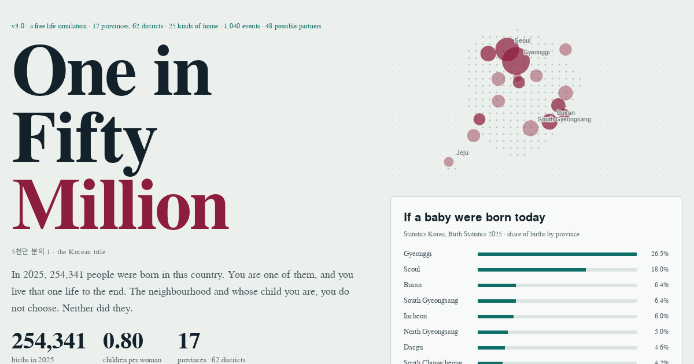

# One in Fifty Million



A browser life simulator set in South Korea. You are born as one of the 254,341 children born there in 2025, drawn by province birth share, household and district, and you live that life to the end in about four minutes.

- **Play in browser**: https://qkrrkdhzdl-arch.github.io/one-in-fifty-million-preview/
- **Play on Reddit (Devvit)**: https://www.reddit.com/r/oneinfiftymillion/
- **Demo video (56s)**: https://youtu.be/_kqgihXMBmk

## How it works

- **Birth draw**: Province birth shares from Statistics Korea's 2025 birth statistics; 17 provinces, 62 districts, 25 kinds of home.
- **Life table & distributions**: Life expectancy from the 2024 life table adjusted for district type, household and generation; income and wealth percentiles from Korean distributions.
- **Events & decisions**: Around 1,040 events and 42 decision cards gated on region, household, era, parents, marriage, children and earlier choices.
- **Bilingual**: Korean and English are written as separate texts; browser language defaults to Korean for `ko` and English otherwise.
- **Zero-backend static build**: Plain HTML, CSS and JavaScript, seeded runs, and a one-click shareable death record.

## Run locally

Open `index.html` through any static file server:

```bash
python3 -m http.server 8080
```

See [GAME_DESIGN.md](GAME_DESIGN.md) for design notes and data sources.
